# Diagramas de comportamiento — AlertaSegura (semana 1)

Cómo se conectan y se comportan las piezas del sistema. Están dibujados con **Mermaid**, que GitHub y VS Code (con la
extensión *Markdown Preview Mermaid Support*) muestran como gráficos. Todos reflejan el código real de la rama
`feat/semana-1`.

> **Versión editable en Excalidraw:** [`diagramas/alertasegura-arquitectura.excalidraw`](diagramas/alertasegura-arquitectura.excalidraw)
> (ábrelo en https://excalidraw.com con *Abrir* o arrastrándolo). Vista previa:
>
> 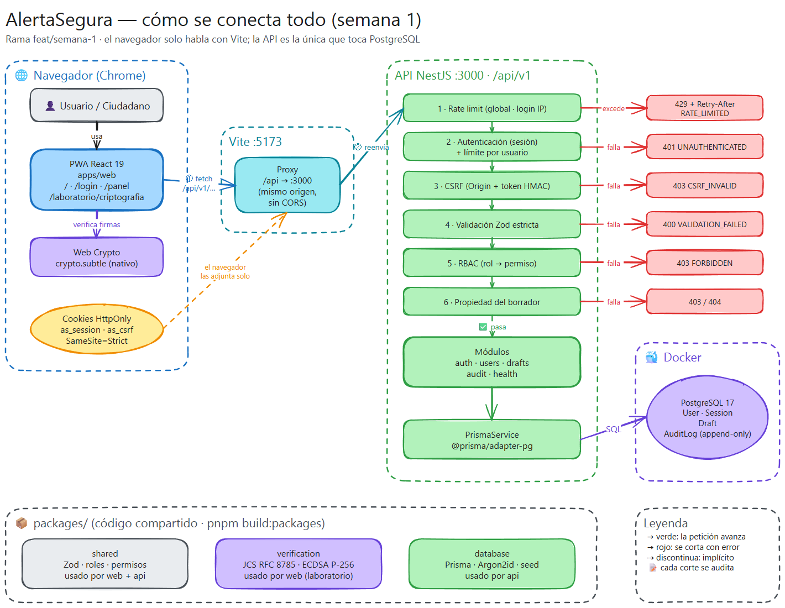

| # | Diagrama | Tipo |
| --- | --- | --- |
| 1 | [Vista general: cómo se conecta todo](#1-vista-general-cómo-se-conecta-todo) | Componentes |
| 2 | [Orden de arranque](#2-orden-de-arranque) | Flujo |
| 3 | [Cadena de controles de cada petición](#3-cadena-de-controles-de-cada-petición) | Actividad |
| 4 | [Carga de la PWA y obtención del token CSRF](#4-carga-de-la-pwa-y-obtención-del-token-csrf) | Secuencia |
| 5 | [Inicio de sesión](#5-inicio-de-sesión) | Secuencia |
| 6 | [Crear un borrador](#6-crear-un-borrador) | Secuencia |
| 7 | [Intento de publicar (P02a, P02b)](#7-intento-de-publicar-p02a-p02b) | Secuencia |
| 8 | [Rate limiting (P09)](#8-rate-limiting-p09) | Secuencia |
| 9 | [Cierre de sesión](#9-cierre-de-sesión) | Secuencia |
| 10 | [Ciclo de vida de una sesión](#10-ciclo-de-vida-de-una-sesión) | Estados |
| 11 | [Laboratorio criptográfico (P13)](#11-laboratorio-criptográfico-p13) | Secuencia |
| 12 | [Roles y permisos](#12-roles-y-permisos) | Componentes |
| 13 | [Modelo de datos](#13-modelo-de-datos) | Entidad-relación |
| 14 | [Auditoría append-only](#14-auditoría-append-only) | Secuencia |

---

## 1. Vista general: cómo se conecta todo

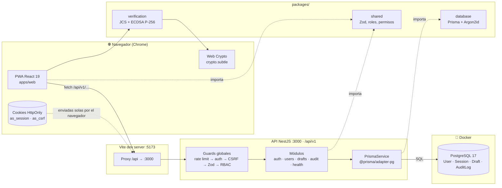

**Cómo se lee:**
- **Peticiones:** el navegador solo habla con Vite (`:5173`), y Vite reenvía todo `/api` a la API (`:3000`). Como para el
  navegador todo tiene el mismo origen, no hace falta CORS.
- **Cookies:** son `HttpOnly`, así que el JavaScript de la PWA no puede leerlas; el navegador las adjunta solo.
- **Base de datos:** la API es la única que habla con PostgreSQL.
- **Verificación de firmas:** ocurre en el navegador con Web Crypto. El frontend nunca tiene una clave privada.

---

## 2. Orden de arranque

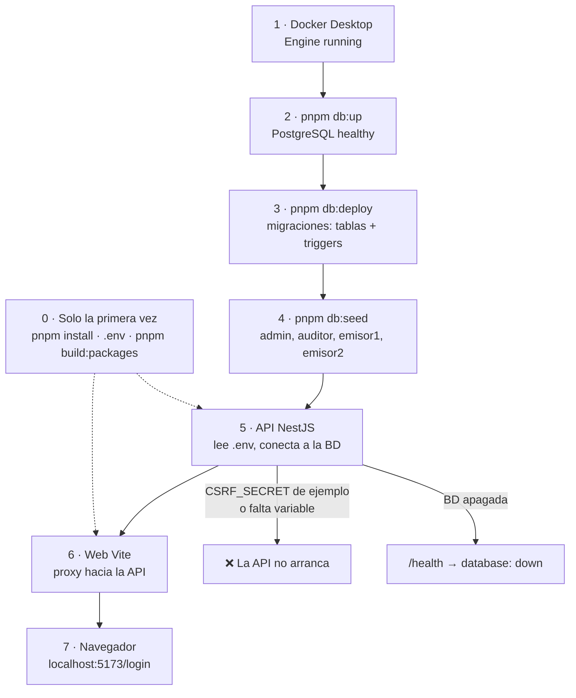

---

## 3. Cadena de controles de cada petición

Los guards globales están registrados en `apps/api/src/app.module.ts` en este orden. El de **propiedad** es un guard de
ruta que Nest ejecuta después de los globales.

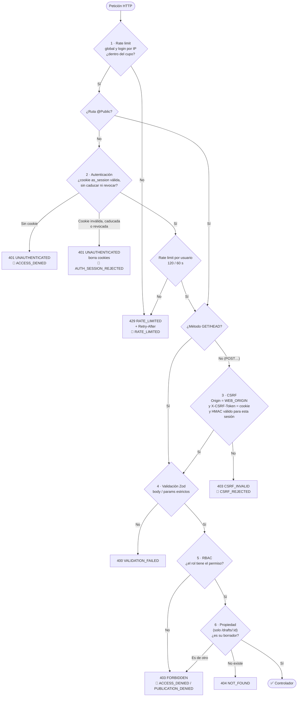

📝 = evento que se escribe en `AuditLog`.

**Por qué en este orden:**
- **Rate limit primero:** frena a quien abusa antes de gastar CPU en Argon2id o en consultas a la base de datos.
- **Autenticación antes que CSRF:** un anónimo siempre recibe 401, nunca 403 (P02a).
- **Validación antes que RBAC:** un cuerpo malformado da 400 sin revelar si tienes permiso.

---

## 4. Carga de la PWA y obtención del token CSRF

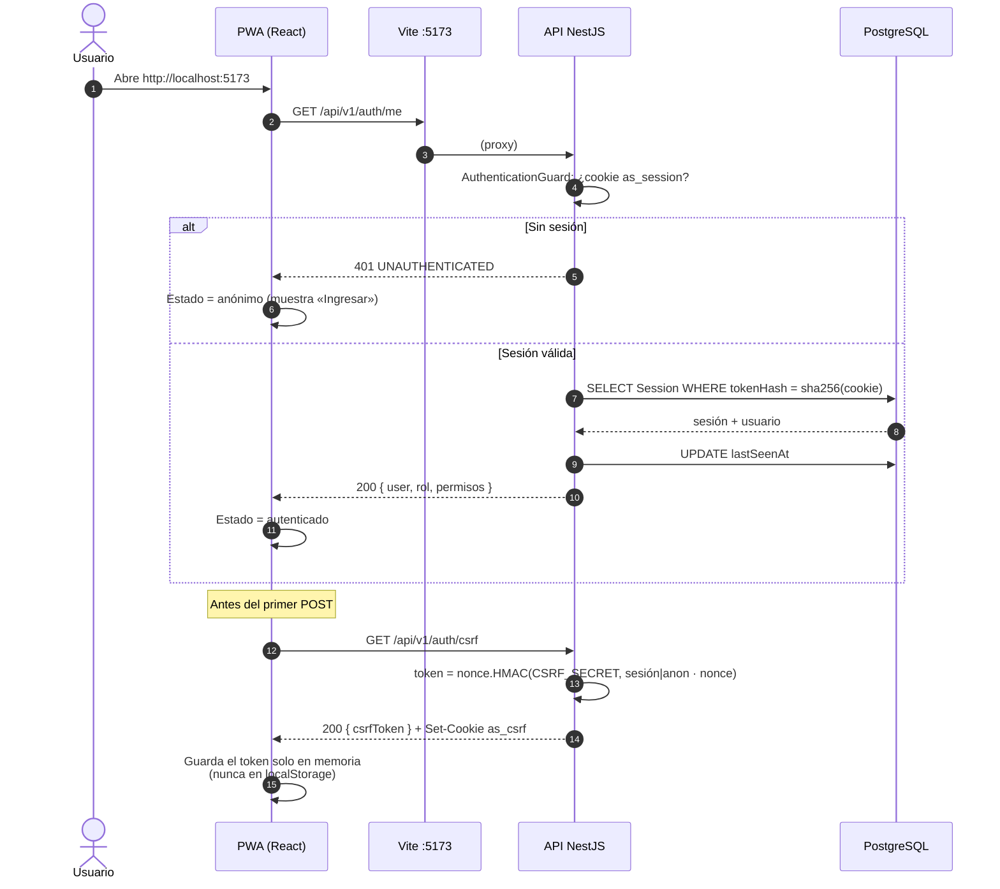

---

## 5. Inicio de sesión

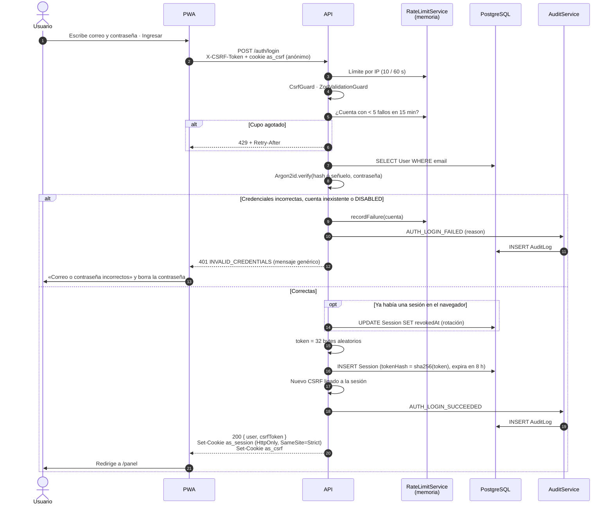

---

## 6. Crear un borrador

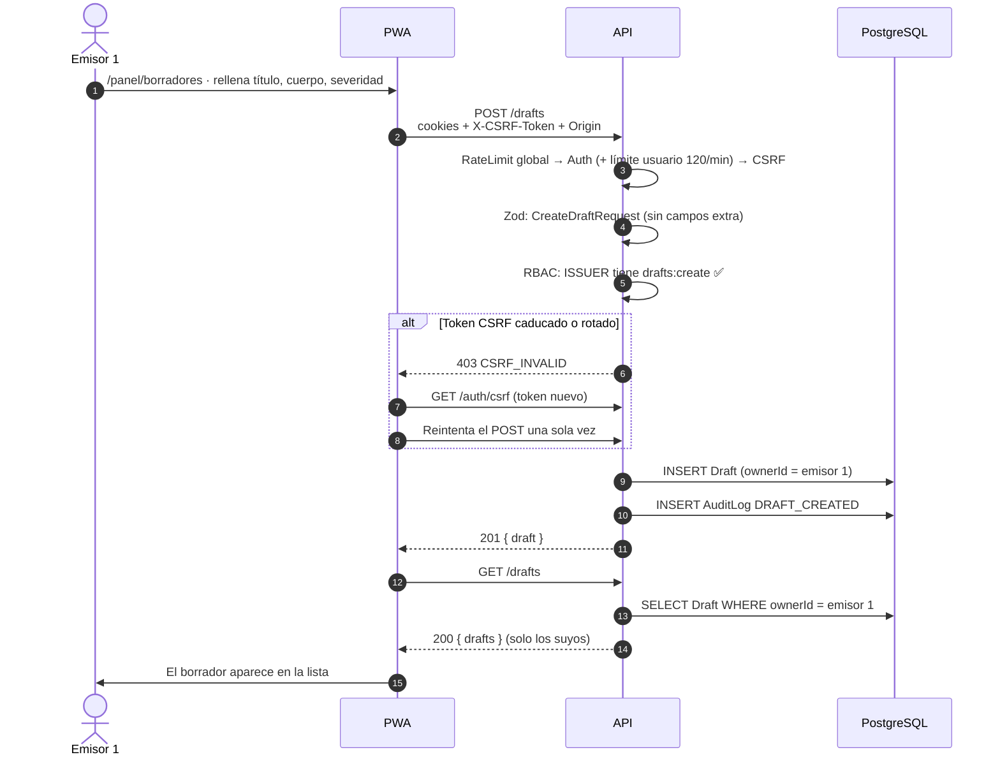

---

## 7. Intento de publicar (P02a, P02b)

En la semana 1 la publicación **se autoriza y se audita**, pero la firma real llega en la semana 2. Por eso, quien
cumple todos los controles recibe **501**.

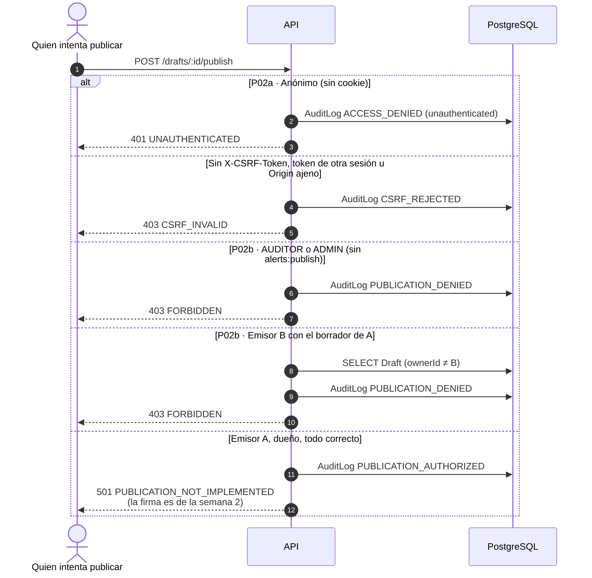

---

## 8. Rate limiting (P09)

Ventana deslizante en memoria. Hay cuatro límites independientes:

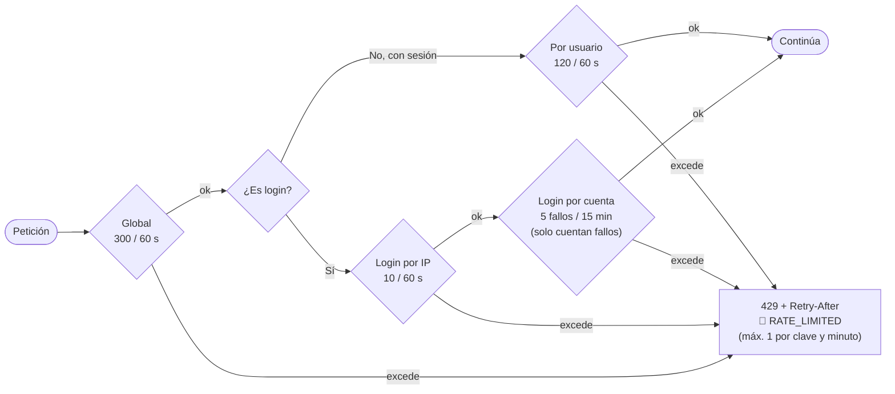

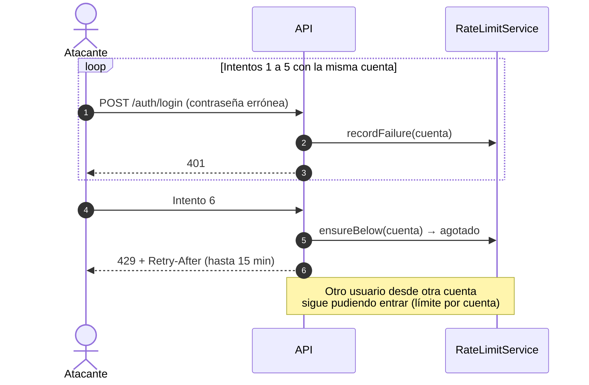

---

## 9. Cierre de sesión

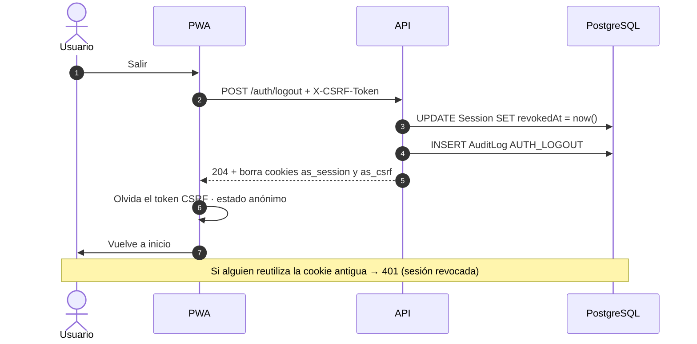

---

## 10. Ciclo de vida de una sesión

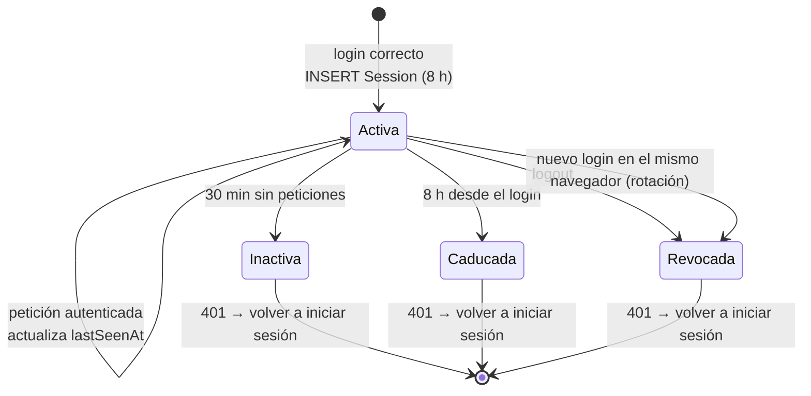

---

## 11. Laboratorio criptográfico (P13)

Comprueba que una firma hecha en **Node.js** se verifica igual en el **navegador**, y que cualquier alteración se rechaza.

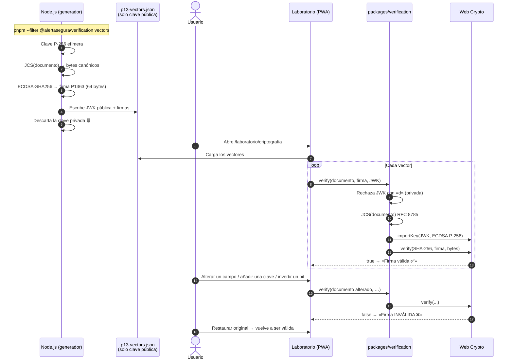

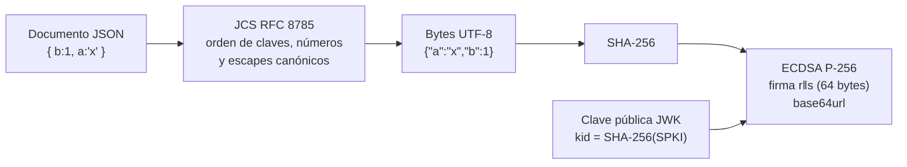

---

## 12. Roles y permisos

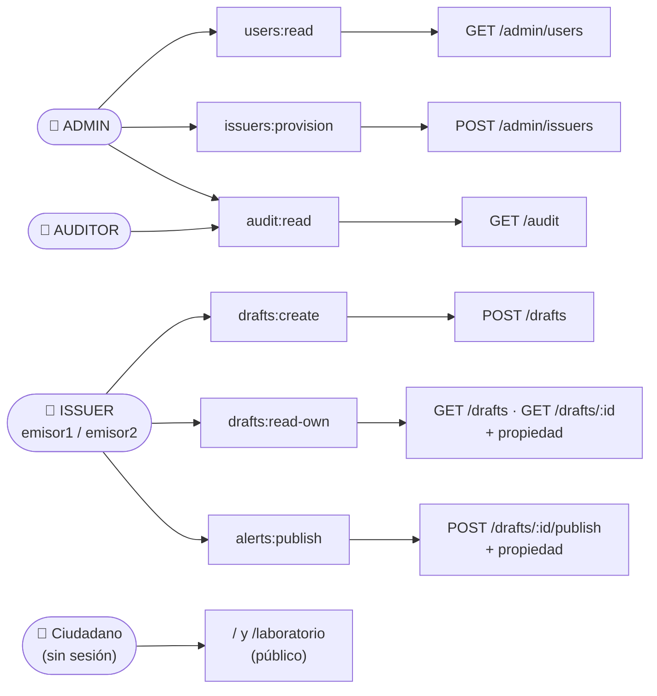

El ADMIN **no** tiene `alerts:publish`: separación de funciones, porque quien gestiona usuarios no puede emitir alertas.

---

## 13. Modelo de datos

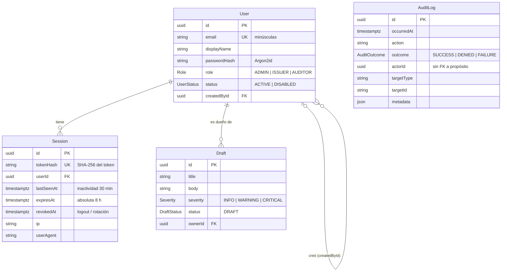

`AuditLog` no tiene clave foránea hacia `User`, para que la evidencia sobreviva aunque cambie la tabla de usuarios.

---

## 14. Auditoría append-only

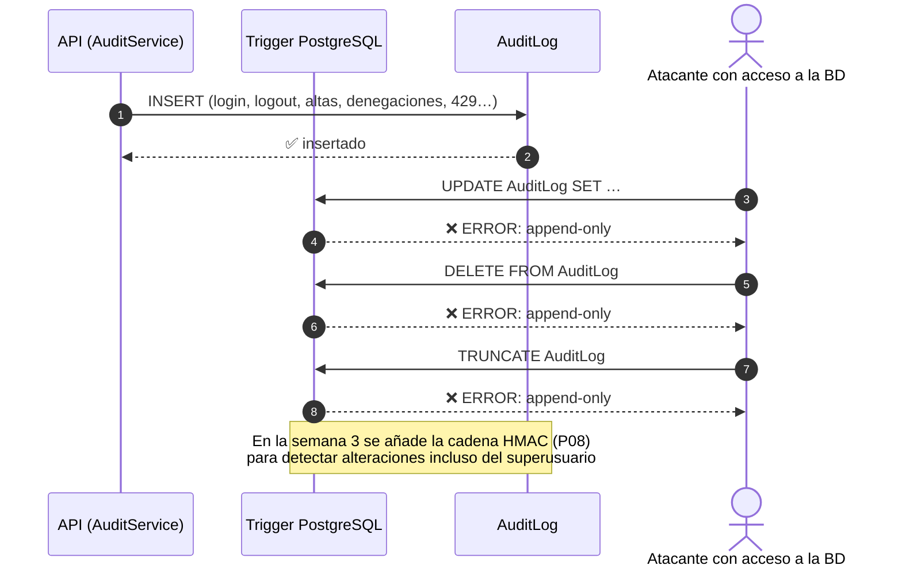

**Eventos que se registran en la semana 1:**

| Evento | Cuándo |
| --- | --- |
| `AUTH_LOGIN_SUCCEEDED` / `AUTH_LOGIN_FAILED` | Login correcto o fallido (con motivo) |
| `AUTH_LOGOUT` | Cierre de sesión |
| `AUTH_SESSION_REJECTED` | Cookie ausente, inválida, caducada o revocada |
| `CSRF_REJECTED` | Falla el token CSRF o el `Origin` |
| `ACCESS_DENIED` | Petición sin sesión a una ruta protegida, o rol sin permiso |
| `RATE_LIMITED` | Se superó un límite (429) |
| `ISSUER_PROVISIONED` | El ADMIN da de alta un emisor |
| `DRAFT_CREATED` | Un emisor crea un borrador |
| `PUBLICATION_DENIED` / `PUBLICATION_AUTHORIZED` | Intento de publicar denegado o autorizado |
