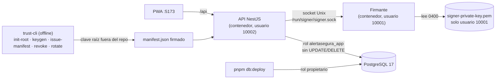
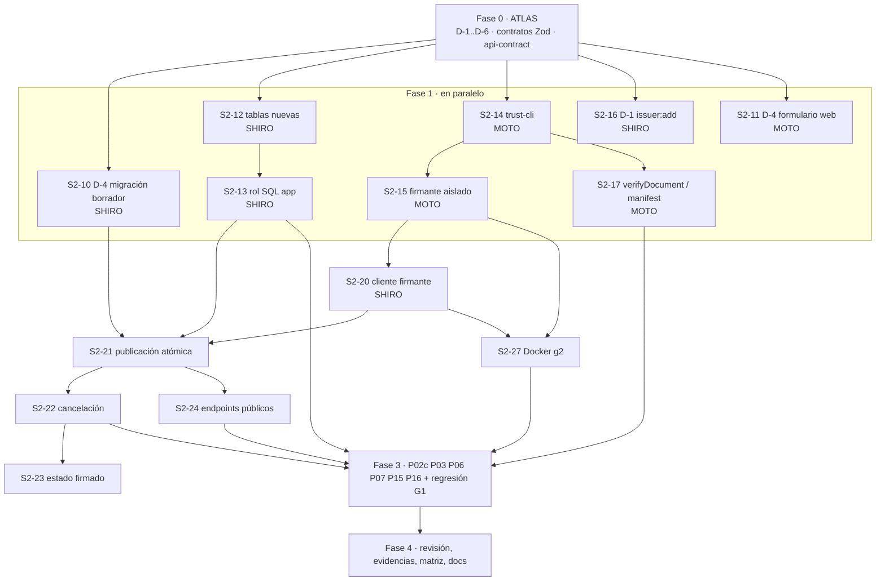

# Plan de la semana 2 — Firma real, publicación inmutable y confianza (GATE G2)

**Proyecto:** AlertaSegura · **Rama de trabajo:** `feat/semana-2` (sale de `feat/semana-1`)
**Equipo:** ATLAS (orquestador) · SHIRO (backend y base de datos) · MOTO (criptografía, firmante y herramientas)
**Referencia oficial:** `AlertaSegura_Propuesta_Definitiva_Seguridad_4_Semanas.pdf`, secciones 03, 06, 07, 08, 10 y 11.

El plan no se organiza por días, sino por **fases con dependencias**. Cada tarea tiene prioridad, responsable, de qué
depende y cómo se acepta. La semana termina cuando se aprueba el GATE G2, no cuando se acaba el calendario.

---

## 1. Objetivo y criterio de cierre

En la semana 1 publicar responde **501**. Al terminar la semana 2:

- Un emisor **publica** una alerta **firmada** por un proceso aislado. Los bytes canónicos quedan guardados tal cual y
  ninguna alerta queda a medias si la firma falla.
- Un emisor **cancela** sus propias alertas mediante un evento firmado que lleva `hash_alerta`.
- Existe un **estado firmado** de corta duración para cada alerta.
- La confianza nace de un **manifiesto firmado por una raíz de prueba** que se gestiona con una CLI offline.
- El rol SQL de la aplicación **no puede** modificar ni borrar publicaciones, eventos ni auditoría.

### GATE G2: pruebas que deben quedar APROBADAS

| Prueba | Escenario | Resultado esperado |
| --- | --- | --- |
| **P02c** | El emisor A cancela una alerta del emisor B | 403 por propiedad; operación auditada |
| **P03 (API)** | Se altera el mensaje, la fecha o la severidad del JSON de una alerta publicada | La firma no verifica; los bytes guardados no cambian |
| **P06 (backend)** | Cancelación válida / evento falsificado + historial | Válida → estado CANCELADA; la falsificada se rechaza; historial visible |
| **P07** | UPDATE o DELETE en SQL sobre una publicación, con el rol de la app | `permission denied` (42501) |
| **P15** | El usuario del proceso API intenta leer la clave de firma | `EACCES` / permiso denegado |
| **P16** | Se sustituye la firma de un EVENTO por la de una ALERTA | Rechazo por `tipo_doc` o porque los bytes no coinciden |

**Regresión obligatoria:** P01, P02a, P02b, P09 y P13 de la semana 1 deben seguir aprobando.

### Fuera de alcance (semanas 3 y 4)

- **Semana 3:** la PWA que verifica alertas (listado, detalle y evidencia), el modo offline, HMAC y checkpoint de
  auditoría, el proxy (P11) y las pruebas P04, P05, P06b, P08 y P10.
- **Semana 4:** la rotación con medición de ventana (P14) y la latencia (P12).
- **Lo que sí se adelanta en la semana 2:** la CLI de revocación y rotación. La medición de la ventana es de la semana 4.

---

## 2. Decisiones previas: D-1 a D-6 (sugerencias de ATLAS)

Hay que resolverlas **antes** de firmar nada: lo que se firma ya no se puede cambiar sin reemitir.

| # | Diferencia | Sugerencia | Por qué | Prioridad |
| --- | --- | --- | --- | --- |
| **D-4** | El borrador tiene `title/body/severity`; la propuesta firma `tipo, zona, severidad, mensaje, emitida_en, expira_en` | **Adoptar los campos oficiales ya.** El borrador pasa a `tipo` (enum), `zona`, `severidad`, `mensaje` y `vigencia` (`expira_en` o duración). `emitida_en` lo pone el servidor al publicar. Hace falta una migración de datos y adaptar la UI | Son los campos que se firman (§07.1). Cambiarlos después obligaría a reemitir alertas y regenerar vectores | **ALTA · bloqueante** |
| **D-1** | Altas de emisores por el ADMIN vía API; la propuesta dice «script del responsable de laboratorio» | **Pasar el alta a un comando de laboratorio** (`pnpm lab issuer:add`) que corre en local contra la BD y audita `ISSUER_PROVISIONED` con el actor `lab-script`. **Retirar `POST /admin/issuers`**: el ADMIN conserva listar usuarios y consultar la auditoría. Ajustar P01 | §03: el administrador «no se autoasigna rol emisor». Encaja con la CLI de confianza, porque el manifiesto lista los `emisor_id` autorizados | **ALTA** |
| **D-2** | Rol extra AUDITOR | **Mantenerlo y documentarlo** como extensión de mínimo privilegio (solo `audit:read`), sin que dé derechos de escritura. Si el tribunal lo pide, se elimina en minutos: solo es una fila en la matriz de roles | Mejora la separación de funciones y no contradice ningún control | BAJA |
| **D-3** | Rutas `/panel` y `/` frente a `/admin` y `/alertas` | **Renombrar en la semana 2**, porque es barato: `/admin` para el panel con sesión y `/alertas` para la consulta ciudadana. Dejar redirecciones desde las rutas antiguas | La semana 3 construye `/alertas`; mejor fijar el nombre ahora | BAJA |
| **D-5** | Sin TLS de laboratorio | **Preparar TLS de laboratorio** con una CA local (`mkcert`): Vite en `https://localhost:5173` y cookies `Secure` y `__Host-` activadas. Hacerlo al final de la semana 2 si hay margen; si no, en la semana 3 junto a P11, que también usa una CA de laboratorio | RNF01 y P01; deja probadas de verdad las cookies seguras | MEDIA |
| **D-6** | NestJS en vez de Express | **Mantener NestJS** y documentar que corre sobre Express (`@nestjs/platform-express`) | Lo exige el mandato del proyecto; no afecta a ninguna prueba | BAJA (solo documentación) |

**Riesgos de la semana 1 que se resuelven ahora:**

- **API con el rol propietario de PostgreSQL:** se resuelve con el rol `app` sin UPDATE/DELETE. Es **imprescindible para P07**.
- **Cuotas de publicación (T8):** se añade un límite de publicaciones por emisor.
- **Purga de sesiones caducadas y CSP:** prioridad BAJA; se hacen si sobra tiempo.

> **Decisión pendiente del autor:** si aceptas estas sugerencias, ATLAS las aplica en la fase 0. Si prefieres otra
> opción para alguna, se cambia aquí antes de empezar.

---

## 3. Arquitectura de la semana 2

**Decisiones técnicas propuestas** (ATLAS las fija en los contratos de la fase 0):

| Tema | Propuesta |
| --- | --- |
| Canal API ⇄ firmante | **Socket Unix** en un volumen compartido (`/run/signer`), con permisos 0660 y grupo compartido. Sin puerto TCP expuesto |
| Aislamiento (P15) | El firmante y la API corren en **contenedores** con usuarios distintos (10001 y 10002). La clave se monta solo en el firmante, en modo 0400. Para P15, la API intenta leer la ruta de la clave → `EACCES` |
| Qué firma el firmante | Solo documentos con `tipo_doc` ∈ {`ALERTA`, `EVENTO`, `ESTADO`} que pasen un esquema Zod **estricto**. Pone él mismo `key_id`, normaliza las fechas a ISO 8601 UTC con segundos, aplica JCS y firma en P1363 |
| Formato guardado | `payload_canonico` en `bytea` (los bytes exactos), `hash_payload` (SHA-256), `firma` (base64url) y `key_id` |
| Publicación atómica | (1) Autorizar → (2) firmar **fuera** de la transacción → (3) `$transaction`: `INSERT alerta` + `INSERT auditoría`. Si algo falla, rollback y respuesta 503; nunca queda una alerta sin firma |
| Estado firmado | `ESTADO` con `secuencia`, `ultimo_evento_hash`, `estado` (`VIGENTE`/`CANCELADA`), `issued_at` y `expires_at` = +10 min. Se regenera cuando caduca o cuando hay un evento nuevo |
| Endpoints públicos (lectura) | `GET /alerts`, `GET /alerts/:id` (bytes, firma, eventos y estado), `GET /trust/manifest` |
| Endpoints de emisor | `POST /drafts/:id/publish` → **201** · `POST /alerts/:id/cancel` → 201 (propiedad + CSRF) |

---

## 4. Reparto del equipo y reglas

| Agente | Responsable de | Carpetas que le pertenecen |
| --- | --- | --- |
| **ATLAS** (orquestador) | Decisiones, contratos compartidos, revisión de cada entrega, integración, aceptación G2 de caja negra, evidencias, documentación y **todos los commits** | `packages/shared`, `docs/`, `tests/security/` |
| **SHIRO** (backend) | Base de datos, migraciones, roles SQL, módulos `alerts` y `trust` de la API, publicación, cancelación, estado, cuotas, Docker de la API y e2e | `apps/api`, `packages/database`, `infra/` (salvo el firmante) |
| **MOTO** (criptografía) | Proceso firmante, CLI de confianza, extensiones de `verification` (`tipo_doc`, manifiesto), vectores P16, formulario de borradores de la web (D-4) y rutas (D-3) | `apps/signer`, `tools/trust-cli`, `packages/verification`, `apps/web`, `infra/docker/signer.Dockerfile` |

**Reglas de trabajo** (las mismas que en la semana 1):

1. **Propiedad de archivos:** nadie edita una carpeta ajena. Si un contrato necesita un cambio, se le pide a ATLAS.
2. **Cumplir el contrato:** los contratos de `packages/shared` y de `docs/coordination/` son la fuente de verdad.
   Si una tarea no puede cumplirlo, se avisa; no se improvisa.
3. **Nada de pruebas falsas:** no se implementa nada para pasar una prueba a la fuerza, y nada se marca como aprobado
   sin haberlo ejecutado.
4. **Ninguna clave privada** en el repositorio, en la API ni en la web. Las claves de laboratorio se guardan en
   `secrets/` (ignorada por Git) o fuera del proyecto.
5. **Reporte de cada entrega:** qué se hizo, qué comandos se ejecutaron y con qué resultado, y qué queda abierto.
   ATLAS revisa y solo después integra y hace el commit.

---

## 5. Plan por fases

Prioridad: **ALTA** = necesaria para G2 o innegociable según la política de recortes (§11 de la propuesta) ·
**MEDIA** = la pide la propuesta pero no bloquea G2 · **BAJA** = mejora o pulido; se recorta primero.

### Fase 0 — Decisiones y contratos (ATLAS) · bloquea todo

| ID | Tarea | Prioridad | Responsable | Depende de | Aceptación |
| --- | --- | --- | --- | --- | --- |
| S2-00 | Confirmar D-1 a D-6 con el autor | ALTA | ATLAS | — | Decisiones registradas en este plan |
| S2-01 | Crear la rama `feat/semana-2` y las fichas de tarea en `docs/coordination/` | ALTA | ATLAS | S2-00 | Fichas `shiro-semana2.md` y `moto-semana2.md` publicadas |
| S2-02 | Contratos Zod en `shared`: `AlertaDocumento`, `EventoDocumento`, `EstadoDocumento`, `Manifiesto`, protocolo del firmante (petición y respuesta), nuevo `Draft` (D-4), respuestas de `/alerts` | ALTA | ATLAS | S2-00 | `pnpm --filter @alertasegura/shared build` en verde; tipos exportados |
| S2-03 | Actualizar `api-contract.md` con los endpoints nuevos, los códigos y el orden de controles | ALTA | ATLAS | S2-02 | Revisado por SHIRO y MOTO sin objeciones |

### Fase 1 — Cimientos (en paralelo: SHIRO y MOTO)

| ID | Tarea | Prioridad | Responsable | Depende de | Aceptación |
| --- | --- | --- | --- | --- | --- |
| S2-10 | **D-4** Migración del borrador a los campos oficiales, con migración de datos de los borradores existentes | ALTA | SHIRO | S2-02 | `db:deploy` en una base nueva y en la de desarrollo; e2e de borradores en verde |
| S2-11 | **D-4** Formulario de borradores en la web con los campos nuevos | ALTA | MOTO | S2-02 | Tests de la web en verde; un borrador se crea desde la UI |
| S2-12 | Tablas `AlertaPublicada`, `EventoAlerta`, `EstadoAlerta` y `ClavePublica` (§08), con `payload_canonico bytea` | ALTA | SHIRO | S2-02 | Migración aplicada; FKs e índices revisados |
| S2-13 | **Rol SQL `alertasegura_app`:** solo `SELECT, INSERT` en publicadas, eventos y auditoría; sin DDL ni TRUNCATE. Las migraciones usan el rol propietario y la API, el rol app (dos URL en `.env`) | ALTA | SHIRO | S2-12 | Una prueba SQL con el rol app → 42501 en UPDATE/DELETE (prepara P07) |
| S2-14 | **trust-cli:** `init-root`, `keygen-signer` (privada 0400 en `secrets/`, pública JWK, `kid` = SHA-256 SPKI), `issue-manifest` (version, issued_at, expires_at 24 h en demo / 7 días, key_id activo, revocadas, emisores autorizados), `revoke`, `rotate` | ALTA | MOTO | S2-02 | Tests unitarios; manifiesto firmado por la raíz y verificable; la raíz nunca se escribe en el repositorio |
| S2-15 | **Firmante aislado:** servidor en socket Unix; valida con Zod estricto según `tipo_doc`; normaliza fechas; JCS; ECDSA P-256 en P1363; devuelve bytes, hash, firma y key_id; rechaza todo lo demás | ALTA | MOTO | S2-02, S2-14 | Tests unitarios (documentos válidos, campos extra, `tipo_doc` desconocido, fechas inválidas); interoperabilidad con `verification` |
| S2-16 | **D-1** Comando de laboratorio `issuer:add` (auditado como `lab-script`) y retirada de `POST /admin/issuers` | ALTA | SHIRO | S2-00 | e2e de P01 actualizado y en verde; el endpoint responde 404 |
| S2-17 | `verification`: `verifyDocument(bytes, firma, jwk, tipoEsperado)` que comprueba `tipo_doc`, más `verifyManifest(manifest, raízJWK)` | ALTA | MOTO | S2-02 | Tests en verde; P13 sigue 46/46 |

### Fase 2 — Núcleo: publicar, cancelar y estado (SHIRO, apoyado por MOTO)

| ID | Tarea | Prioridad | Responsable | Depende de | Aceptación |
| --- | --- | --- | --- | --- | --- |
| S2-20 | Cliente del firmante en la API (socket, timeout, errores → 503 sin efectos) | ALTA | SHIRO | S2-15 | Tests con un firmante falso y uno real |
| S2-21 | **Publicación atómica:** `POST /drafts/:id/publish` → 201. Firma fuera de la transacción; `INSERT` de la alerta y de la auditoría `ALERT_PUBLISHED` juntos; si algo falla, rollback | ALTA | SHIRO | S2-12, S2-13, S2-20 | e2e: alerta con bytes exactos; firmante caído → 503 sin fila; fallo de auditoría → rollback |
| S2-22 | **Cancelación:** `POST /alerts/:id/cancel` → propiedad (P02c), CSRF, EVENTO firmado con `hash_alerta`, `INSERT` del evento y de la auditoría en una transacción | ALTA | SHIRO | S2-21 | e2e: el dueño cancela (201); otro emisor → 403 auditado; cancelar dos veces → 409 |
| S2-23 | **Estado firmado:** generación del ESTADO (secuencia, último hash, +10 min) y regeneración al caducar o al haber un evento nuevo | ALTA | SHIRO | S2-22 | e2e: tras cancelar, el estado es CANCELADA con secuencia+1; tras 10 min se regenera |
| S2-24 | Endpoints públicos `GET /alerts`, `GET /alerts/:id` (bytes base64url, firma, key_id, eventos y estado) y `GET /trust/manifest` | ALTA | SHIRO | S2-21 | e2e; un ciudadano consulta sin sesión; no existe escritura pública |
| S2-25 | Registro de `ClavePublica` (metadatos) a partir del manifiesto; la confianza viene **solo** del manifiesto | MEDIA | SHIRO | S2-14 | e2e; documentado que la tabla no es una autoridad paralela |
| S2-26 | **Cuotas de publicación** por emisor (T8), por ejemplo 10 por hora → 429 | MEDIA | SHIRO | S2-21 | e2e con un límite configurable por `.env` |
| S2-27 | Docker de la semana 2: perfil con `api` (usuario 10002) + `signer` (usuario 10001) + `postgres`, con volumen de socket y montaje de la clave solo en el firmante | ALTA | SHIRO (API y compose) + MOTO (Dockerfile del firmante) | S2-15, S2-20 | `docker compose --profile g2 up` levanta todo; health OK |

### Fase 3 — Pruebas del GATE G2

| ID | Tarea | Prioridad | Responsable | Depende de | Aceptación |
| --- | --- | --- | --- | --- | --- |
| S2-30 | **P02c** e2e + caja negra | ALTA | SHIRO (e2e) + ATLAS (caja negra) | S2-22 | 403 por propiedad y `CANCEL_DENIED` en la auditoría |
| S2-31 | **P03 API:** alterar mensaje, fecha o severidad de la respuesta → `verifyDocument` falla; los bytes en BD coinciden con `hash_payload` | ALTA | ATLAS + MOTO | S2-24, S2-17 | Pruebas en verde con evidencia JSON |
| S2-32 | **P06 backend:** cancelación válida → CANCELADA; eventos falsificados (otra clave, `hash_alerta` alterado, firma de ALERTA) → rechazo; historial visible | ALTA | SHIRO + MOTO | S2-22, S2-17 | Pruebas en verde |
| S2-33 | **P07:** UPDATE/DELETE con el rol app sobre publicadas, eventos y auditoría → 42501 | ALTA | SHIRO | S2-13 | Prueba SQL real; evidencia del error |
| S2-34 | **P15:** desde el contenedor de la API, `readFile(clave)` → EACCES; la API no tiene la ruta montada | ALTA | MOTO + SHIRO | S2-27 | Salida real del comando como evidencia |
| S2-35 | **P16:** vectores con la firma de un EVENTO puesta en una ALERTA (y al revés) → rechazo por `tipo_doc` o por bytes | ALTA | MOTO | S2-17 | Vectores en `tests/fixtures/crypto/p16-vectors.json`; pruebas en verde |
| S2-36 | **Regresión G1:** P01 (con D-1), P02a, P02b, P09 y P13 | ALTA | ATLAS | Fase 2 | Los mismos resultados que en la semana 1 |

### Fase 4 — Cierre (ATLAS)

| ID | Tarea | Prioridad | Responsable | Depende de | Aceptación |
| --- | --- | --- | --- | --- | --- |
| S2-40 | Revisión de seguridad del diff de la semana 2 (firmante, socket, roles SQL, transacción) | ALTA | ATLAS | Fase 3 | Sin hallazgos abiertos de severidad alta |
| S2-41 | Evidencias en `docs/evidence/g2/` y reporte `semana2-cumplimiento.md` | ALTA | ATLAS | Fase 3 | Cada prueba con su evidencia enlazada |
| S2-42 | Actualizar la matriz T1–T11: T2, T5, T6 y T10 pasan a mitigado o parcial según los resultados | ALTA | ATLAS | S2-41 | Matriz coherente con las pruebas ejecutadas |
| S2-43 | Procedimiento de laboratorio: crear la raíz, emitir el manifiesto, revocar y rotar (guía paso a paso) | MEDIA | ATLAS + MOTO | S2-14 | Guía reproducible desde cero |
| S2-44 | Actualizar la arquitectura, el modelo SQL (Excalidraw incluido), la guía de inicio y los diagramas | MEDIA | ATLAS | Fase 2 | Diagramas coherentes con el código |
| S2-45 | **D-5** TLS de laboratorio con `mkcert` y cookies `Secure` y `__Host-` | MEDIA | SHIRO + MOTO | Fase 3 | Login por HTTPS con las cookies seguras comprobadas |
| S2-46 | **D-3** Renombrar las rutas a `/admin` y `/alertas` con redirecciones | BAJA | MOTO | S2-11 | Tests de la web y recorrido en Chrome en verde |
| S2-47 | Recorrido en Chrome: publicar y cancelar desde la UI (evidencia complementaria) | BAJA | ATLAS | S2-21, S2-22 | Capturas en `docs/evidence/g2/navegador/` |
| S2-48 | Purga de sesiones caducadas y CSP básica | BAJA | SHIRO | — | Tests en verde |

---

## 6. Orden de ejecución y dependencias

**Camino crítico:** contratos → trust-cli → firmante → cliente del firmante → publicación → cancelación → pruebas G2.
Todo lo demás corre en paralelo a esta cadena.

---

## 7. Política de recortes (si el tiempo no alcanza)

Siguiendo §11 de la propuesta:

1. **Se recorta primero lo BAJA:** S2-46, S2-47 y S2-48.
2. **Después lo MEDIA:** S2-45 (TLS pasa a la semana 3 con P11), S2-26 (cuotas), S2-25 (inventario de claves) y
   S2-43/S2-44 se reducen a lo mínimo.
3. **Nunca se recorta:** el aislamiento del firmante, la publicación atómica, los permisos SQL, la cancelación con
   `hash_alerta`, el `tipo_doc`, los vectores de firma, los casos negativos ni las evidencias.
4. **Si el estado firmado (S2-23) no llega**, se documenta como no implementado y P06b (semana 3) no podrá afirmar
   resistencia a la supresión de cancelaciones.

---

## 8. Riesgos del plan

| Riesgo | Impacto | Mitigación |
| --- | --- | --- |
| Socket Unix y usuarios del sistema en Windows | La API y el firmante no se aíslan bien fuera de Linux | Ejecutarlos en contenedores Linux (S2-27). En Windows no se ejecuta P15 fuera de Docker |
| Cambiar D-4 rompe las pruebas de la semana 1 | Regresiones en P02b y en la web | Se hace al principio y se corre la regresión G1 antes de seguir |
| Los dos agentes editan en el mismo repositorio a la vez | Conflictos | Reparto estricto por carpetas; solo ATLAS hace commits; `shared` es solo de ATLAS |
| La clave de laboratorio se filtra al repositorio | Fallo grave de seguridad | `secrets/` en `.gitignore` + escaneo de secretos antes de cada commit (ATLAS) |
| Desfase entre el firmante y `verification` | P13 o P16 fallan | Un único contrato de documentos en `shared` y vectores compartidos |

---

## 9. Entregables de la semana 2

- Rama `feat/semana-2` con commits por área.
- Firmante aislado, CLI de confianza y manifiesto de prueba (sin claves privadas versionadas).
- Publicación, cancelación y estado firmados en la API, con el rol SQL de mínimo privilegio.
- `docs/evidence/g2/` con P02c, P03, P06, P07, P15 y P16, y la regresión de G1.
- `docs/evidence/semana2-cumplimiento.md`, la matriz T1–T11 actualizada y el procedimiento de revocación.
